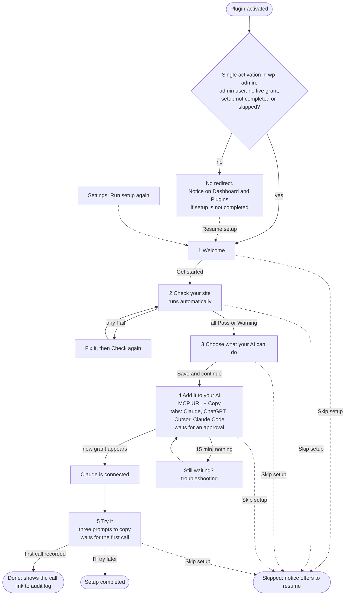

# First-run setup wizard

**Status:** built 2026-10-26 (plugin side). **Changed in 0.9.0 and 0.10.0** (docs/mcp-in-plugin.md §9, §10): there is no MCPMate server any more. The live wizard has four steps (Welcome, Choose what your AI can do, Add it to your AI, Try it) and shows the site's own MCP URL. The old “Check your site” onboarding step described below has been removed; hosting checks remain available from the Dashboard's Site checks card. Step 3 "Connect this site" and the checks `cloud_config`, `outbound`, `clock`, `inbound` and `rest_api` are gone; §1 is the audit from before the build and still describes the cloud; §6 is kept only as a record. Open questions 3, 4, 5, 6, 7, 13 and 14 were answered before building (see §13).
**Goal:** a site admin goes from "plugin activated" to "my AI made its first successful call" in under 3 minutes, without a support ticket.
**Read with:** `AGENTS.md` (rules, layout, known gaps), `docs/mcp-in-plugin.md` (the MCP URL, the OAuth server, §10 hosting risks) and `docs/ui.md` (the Dashboard's Site checks card shows the same rows).

---

## 1. Audit: what exists today

_Written before the build, when the MCPMate cloud still connected each site. Kept as the record of what the wizard was designed against._

The wizard reuses everything below. It adds one admin route, one option, three admin-ajax routes and a few small backend changes (§12). It adds no REST route.

### 1.1 Admin stack

- React 18 + **Ant Design 5** + Tailwind 3 (preflight off), React Query, jotai, hash router (`frontend/src/AppRoutes.tsx`). `@wordpress/components` is **not** installed; only `@wordpress/i18n` is. The wizard uses Ant Design like every other page, with the existing WordPress-blue theme tokens (`frontend/src/config/theme.ts`). Adding `@wordpress/components` would add a second design system and a runtime npm dependency for one page, so this design does not.
- PHP renders only the mount point (`Views/Body`, `Head`, `Layout`). `Head::createFrontendConfig()` injects `SERVER_VARIABLES` (nonce, `connection` summary, `connectRequest`).
- `Layout::removeAdminNotices()` removes **all** admin notices on the plugin's own pages. The "resume setup" notice (§10.3) therefore shows only on other admin screens.
- `Layout::sendFrameHeaders()` sends `X-Frame-Options: DENY` on every `?page=mcpmate` request. The wizard gets this for free.

### 1.2 Admin pages (all `manage_options`, `Menu.php`)

| Route                            | Page                  | What the wizard reuses                                                                                                                                                                                         |
| -------------------------------- | --------------------- | -------------------------------------------------------------------------------------------------------------------------------------------------------------------------------------------------------------- |
| `#/`                             | `pages/Dashboard`     | Connection card: status tag, plugin version, `McpUrl`, link to `#/connection`. Gets a "Finish setup" card (§10.4).                                                                                             |
| `#/connection`                   | `pages/Connection`    | Connect / Reset connection and the register-then-poll loop (`register()`, 60 s limit), MCP URL, registered address, last signed request, key id, and an "Add it to your AI app" card with one line per client. |
| `#/connect`                      | `pages/Connect`       | The AI-app approval screen, opened from `?connect=<token>` (`utils/connectLink.ts`). Approve or Deny, then `goTo()` the cloud callback (origin-checked by `isCloudUrl`).                                       |
| `#/connected-apps`               | `pages/ConnectedApps` | Grants table: client name, vouched-by, redirect host, access, acts as, approved, last used, status (`Waiting for first use` = pending), Revoke, Revoke all, limit "n of 25".                                   |
| `#/approvals`, `#/approvals/:id` | `pages/Approvals`     | Not used by the wizard, only mentioned in the Welcome copy.                                                                                                                                                    |
| `#/audit-log`                    | `pages/AuditLog`      | Target of the "See it in the audit log" link (§9). It does not read filters from the URL today.                                                                                                                |
| `#/settings`                     | `pages/Settings`      | A boilerplate "Example settings form", then seven feature cards: `CoreProxy`, `CliCommands`, `Abilities`, `DbInspect`, `MediaUploads`, `ThemeDrafts`, `ElementorPages`.                                        |

Shared components: `components/McpUrl.tsx` (read-only input + Copy, toast on success or failure) and `components/ConnectionStatusTag.tsx` (`connected`, `not_connected`, `not_configured`, `needs_reset`, `address_changed`).

### 1.3 Registration and approval flow (connection v2)

- **Register:** admin-ajax `connection/register {reset}` → `Registrar::start()` creates `reg_id` and `reg_key`, stores them in transient `MCPMATE_registration` (15 min), calls `CLOUD_URL/api/v1/sites/register`, and gets back 202. The cloud then calls `GET ?rest_route=/mcpmate/v1/connection/challenge&reg_id=&challenge=` (public route; 404 unless that `reg_id` is pending; 30/min per IP). The admin page polls `connection/register-status` → `Registrar::poll()` until `{status: connected}`. Failures arrive as a `WP_Error` with a plain message: `mcpmate_cloud_not_configured` (409), `mcpmate_already_connected` (409), `mcpmate_site_already_registered` (409), `mcpmate_cloud_error` (502, with the cloud's message cut to 300 chars), and `mcpmate_no_registration` (404).
- **Important for the wizard:** the cloud's challenge can only succeed **during a registration**. Without a pending `reg_id` the route answers 404 by design (T17). So "the cloud can reach this site" cannot be tested before registering without a new cloud endpoint. §6 makes the registration itself that test.
- **Approve an AI app:** the cloud sends the browser to `admin.php?page=mcpmate&connect=<token>`. `Head::connectRequest()` verifies the token, `#/connect` shows it, and admin-ajax `connection/approve {token, read_only}` creates a grant with status **`pending`**, then returns the cloud callback. The grant becomes **`active` on its first verified signed request** (`Grants::markUsed()` in `SignedAuth::verify()`). `last_used_at` is updated at most once a minute.
- **Grants:** `{prefix}mcpmate_grants`. Admin-ajax `grants/list` returns `{grants: Grant[], limit}` (newest first, revoked ones kept for 30 days).
- **Last signed request:** option `MCPMATE_connection_last_signed`, written at most once a minute and shown as `last_signed_at` in `Connection::summary()`.

### 1.4 Stored options and state

| Option (via `Config::withPrefix`)                | Owner                                                     | Default |
| ------------------------------------------------ | --------------------------------------------------------- | ------- |
| `connection`                                     | `Connection` (site_id, cloud_url, addresses, sealed keys) | none    |
| `registration` (transient, 15 min)               | `Registrar`                                               | none    |
| `connection_last_signed`                         | `SignedAuth`                                              | none    |
| `core_proxy`                                     | `CoreProxySettings`                                       | off     |
| `cli_commands` (enable list)                     | `CommandSettings`                                         | `[]`    |
| `abilities` (enable list)                        | `AbilitySettings`                                         | `[]`    |
| `db_inspect`                                     | `DbInspectSettings`                                       | off     |
| `media_upload`                                   | `MediaSettings`                                           | off     |
| `theme_drafts`                                   | `ThemeDraftSettings`                                      | off     |
| `elementor`                                      | `ElementorSettings`                                       | off     |
| `settings`, `version`, `db_version`, `installed` | boilerplate / installer                                   |         |

### 1.5 Endpoints the wizard can reuse

| Endpoint                                                                                                                                                              | Used in step                                                                                                                                   |
| --------------------------------------------------------------------------------------------------------------------------------------------------------------------- | ---------------------------------------------------------------------------------------------------------------------------------------------- |
| admin-ajax `connection/status` (`{connection, registration: "pending" \| null}`)                                                                                      | 3, plus resume                                                                                                                                 |
| admin-ajax `connection/register`, `connection/register-status`                                                                                                        | 3                                                                                                                                              |
| admin-ajax `grants/list`                                                                                                                                              | 5 (and 4 on a re-run)                                                                                                                          |
| admin-ajax `core-proxy[/update]`, `cli-commands[/update]`, `abilities`, `db-inspect[/update]`, `media-upload[/update]`, `theme-drafts[/update]`, `elementor[/update]` | 4 (safety settings)                                                                                                                            |
| `GET /ping` (signed or cookie, `manage_options`)                                                                                                                      | Basis of the loopback check (§4, check 3): an unsigned request with only `X-MCPMate-Version` gets a 401 envelope `mcpmate_signature_malformed` |
| `SiteInfo::collect()` (PHP), Abilities `isSupported()`, `ElementorPages::isAvailable()`, `current_user_can('edit_themes')`                                            | 2, 4                                                                                                                                           |

### 1.6 Findings that need a refactor

1. **The register-and-poll loop lives inside `pages/Connection/index.tsx`.** Move it to `services/registration.ts` (`register(reset)`, or a `useRegistration()` hook) so the wizard and the Connection page share it.
2. **The client instructions on the Connection page are hard-coded and partly out of date.** Claude's custom connectors now live under _Customize → Connectors → + Add → Add custom connector_, and ChatGPT moved custom MCP servers to its _Plugins_ page ("Add custom MCP server"); the page still says "Settings → Connectors (developer mode)". Move all of it into one data file (§8.1) used by both pages.
3. **Each Settings card is self-contained** (its own query, mutation, toast and `Card`). Extract a `useFeatureSwitch(route)` hook plus a presentational `FeatureSwitchRow` so the wizard and Settings render the same switch with the same copy.
4. **The boilerplate "Example settings form"** (`SettingsController`, option `settings`, `SERVER_VARIABLES.settings`, the REST `GET /settings` route behind `isAdmin`) is dead code on the MCP surface. Remove it. The top of Settings becomes the "Run setup again" link (§10.5).
5. **The first read-only call leaves no trace an admin page can see.** Reads are not audited (`RestController::AUDIT_READS` is false outside `DbController`), so "Give me a health summary" (`GET /site-info`) writes no audit row. The grant's `pending → active` change shows _that_ a call came, not _which_ one. §12.2 (item 2) adds a once-per-grant "first call" audit row.
6. **A signed request refused before a controller is invisible** (known gap 5). When the AI's first call fails on clock skew, transport or a changed address, the wizard has nothing to show. §12.2 (item 3) adds a "last refusal" record (code and time only).
7. **SVG uploads have no switch of their own.** Today any `manage_options` user can upload SVG as soon as Media uploads is on (`MediaUploader`, `SVG_FORBIDDEN` only for non-admins). §7 adds `media_svg`.
8. **`Registrar::cloudError()` flattens cloud failures into one message**, so the wizard cannot say _why_ the challenge failed. §6.1 and §12.4 propose structured reasons, which is a contract change in both copies of `connection-v2.md`.
9. **The AuditLog page ignores the URL.** Let it read `tool`, `result` and `grant_id` from the hash query (`#/audit-log?tool=connection&grant_id=…`) so the wizard can link to the row.
10. **Uninstall misses options.** `MCPMatePluginOptions::down()` deletes `cli_commands`, `connection`, `connection_last_signed` and `core_proxy`, but not `db_inspect`, `media_upload`, `theme_drafts`, `elementor` or `abilities`. Add those, plus the new options in §12.3. The theme draft and backup records are a separate decision, because their files stay on disk (known gaps 16 and 18). That is open question 14.
11. **The Connection page's "Connect to MCPMate" call can collide with the wizard's.** `Registrar::start()` overwrites a pending registration, so a second click (or a second tab) kills the first poll. Both UIs must check `connection/status` → `registration === "pending"` and resume polling instead of starting again.

---

## 2. Flow

Step order changes from the brief, for two reasons:

- **Safety settings move before connecting the AI (step 4).** The admin decides what the AI may do _before_ granting access ("capability first, then allowlist, then action"). It also keeps the user from bouncing back to the wizard tab between approving and typing their first prompt.
- **"Add it to your AI" and "Approve" become one step (step 5).** The approval page opens seconds after the URL is pasted, often before the user could click "Next" in the wizard. That step therefore starts waiting for the grant as soon as it opens, and shows the approval as a live status line.



Numbering used below: **1 Welcome · 2 Check · 3 Safety settings · 4 Add to your AI (incl. approve) · 5 First success**. (An earlier design had a step "Connect this site" that registered the site with the cloud between 2 and 3; §6 records it.)

Time budget for the 3-minute goal: Welcome 5 s, checks ≤ 25 s (usually 1–3 s), safety 20 s, adding the connector 45–75 s, approval 15 s, first prompt 20–30 s. That is about 2½ minutes for a public HTTPS site. Local sites need a tunnel first and will take longer; the wizard says so up front (§5.1, `environment`).

---

## 3. Common to every step

**Route:** `#/setup`, page `frontend/src/pages/Setup/` (one file per step under `steps/`). `admin.php?page=mcpmate&setup=1` maps to `#/setup` (`utils/setupLink.ts`, same pattern as `approvalLink.ts`). Not in the admin menu, so it does not clutter the sidebar.

**Frame:** a single column, max 720 px, on the WordPress admin background.

- Top: `MCPMate setup` (small, secondary), a progress list ("Step 2 of 5: Check your site"), and **Skip setup** (link button, top right).
- Body: the step's `<h2>` heading, then its content.
- Bottom: the primary action on the right, **Back** (secondary) on the left from step 2 on. Back never undoes anything; it only shows the earlier step.

**Progress list:** an `<ol aria-label="Setup progress">` with five items. Each item has a text state ("done", "current", "not started") as well as an icon, and the current item carries `aria-current="step"`. Ant Design's `Steps` renders `div`s, so wrap it or render the list directly.

**Skip setup:** Popconfirm: _"Skip setup? You can come back to it from Settings at any time."_ → **Skip** / **Keep going**. This sets status `skipped` and goes to the Dashboard. Nothing already done is undone.

**Saved progress:** every step change calls `onboarding/update {step}`. A reload opens `#/setup` at the saved step. Steps that wait for something (4, 5) resume waiting on load.

**Errors common to every step:**

| Situation                      | Detection                       | Copy                                                                                                                                    | Recovery               |
| ------------------------------ | ------------------------------- | --------------------------------------------------------------------------------------------------------------------------------------- | ---------------------- |
| Session expired or nonce stale | admin-ajax answers `-1`/`0`/403 | "Your WordPress session has expired. Reload the page to continue. Your progress is saved."                                              | **Reload page** button |
| Network error to admin-ajax    | `fetch` throws                  | "Couldn't reach your site. Check your connection and try again."                                                                        | **Try again**          |
| Unexpected server error        | 500 / invalid JSON              | "Something went wrong on your site (error {code}). Try again. If it keeps happening, the audit log or your PHP error log may say more." | **Try again**          |

**Polling rules (steps 4, 5):**

- Interval: every 3 s.
- Polling pauses while the tab is hidden (`visibilitychange`), and runs once more as soon as the tab is visible again.
- It stops after 15 minutes and shows a "still waiting" state with **Keep waiting**. Nothing the user is in the middle of is ever time-limited (WCAG 2.2.1).

**Same-browser shortcut:** after Approve or Deny, `pages/Connect` posts `{type: "grant-approved" | "grant-denied", grant_id?, client_name}` on a `BroadcastChannel("mcpmate")`. The wizard listens and reacts at once; polling remains the fallback (other browser or device, no BroadcastChannel). The message holds no token or secret.

**Accessibility (every step):**

- On each step change, focus moves to the step `<h2>` (`tabIndex={-1}`, `ref.focus()`), and the document title becomes "Step 2 of 5: Check your site ‹ MCPMate setup".
- One `aria-live="polite"` region per page announces state changes: check summaries, "Claude is connected", "First call received". Each result is announced once, not on every poll.
- Status is never shown by colour alone. Every pass, warning, fail or waiting state has an icon **and** a word ("Passed", "Warning", "Failed", "Waiting"), and icons carry `aria-hidden` next to the visible word.
- Everything is reachable by keyboard: native buttons and links, Ant Design `Tabs` (arrow keys), Copy buttons with an accessible name ("Copy MCP URL", "Copy prompt 1"), and Popconfirm returns focus to its trigger.
- Spinners sit inside `aria-busy="true"` containers with visible text ("Checking…"), and nothing moves for users with `prefers-reduced-motion`.
- Steps that advance by themselves (4 → 5) do so only after announcing it, and move focus to the new heading. The success state stays until the user acts.

**Copy rules:** short sentences, second person, no internal terms (no "grant", "bearer token", "REST_NS", "OAuth client"). The first time a term appears it gets one line:

- **MCP:** "MCP (Model Context Protocol) is the standard way AI apps connect to other tools and services."
- **Connector:** "A connector is how your AI app links to an outside service, like this site."

**Privacy:** the wizard sends nothing anywhere. Step 2's requests go only to this site's own public address (its tunnel when `MCPMATE_PUBLIC_URL` is set). There is no analytics, telemetry or "how did setup go" ping. If one is ever wanted, it needs its own opt-in checkbox, off by default, and a `readme.txt` disclosure.

---

## 4. Step 1: Welcome

**Purpose:** say what the plugin does and what it will never do, in under 10 seconds.

**UI:** heading, one sentence, three promise rows (icon + bold title + one line), primary button, and a small "takes about 3 minutes" note.

**Copy:**

> ## Connect your AI to this site
>
> MCPMate lets AI apps such as Claude, ChatGPT and Cursor work on your WordPress site, with you in control.
>
> - **Drafts by default.** Posts and pages the AI writes are saved as drafts. Publishing stays with you.
> - **Deletes go to the trash.** The AI can move things to the trash, never delete them for good.
> - **Risky actions wait for you.** Things like switching themes or changing plugins need your approval on this site first.
>
> Setup takes about 3 minutes. **[Get started]**

These three promises hold for the plugin's own tools. Abilities from other plugins are the exception (known gap 21), so step 4 says so where abilities appear, rather than weakening the Welcome copy.

**States:** static. On a re-run of a completed setup the button reads **Start again**, plus a line: "Your site is already connected. Running setup again changes nothing until you choose to."

**Data:** `onboarding/update {step: "check", status: "in_progress"}` on click.

**Edge cases:** the user is on a multisite network admin screen. This cannot happen, because the wizard lives in the site admin; network activation never redirects (§10.1).

---

## 5. Step 2: Check your site

**Purpose:** catch the hosting problems that cause most failed connections _before_ the user pastes anything (docs/mcp-in-plugin.md §10).

**UI:** heading, one intro line, then a list of check rows (icon, title, status word, one-line result). A row that needs action expands with a **How to fix** panel: the fix sentence first, then the lines it names (`details`), each code line with a Copy button. A row that passed can still carry a note with lines (the addresses to keep out of a cache, the firewall paths). Below the list: summary line, **Check again** (secondary) and **Continue** (primary).

**Copy:**

> ## Check your site
>
> We're checking that AI apps can reach your site and sign in. Your site only asks itself; none of your content leaves your site.

Summary line (also announced in the live region): "All checks passed." / "{n} warnings. You can continue, but read them first." / "{n} problems need fixing before you can connect."

**Run:** on entering the step, admin-ajax `onboarding/checks` runs every check server-side in one request and returns `{checks: [{id, status: pass|warn|fail|info|later, title, message, fix, details: [{text, code?}]}], summary}`. The rows render together. Before the response arrives, every row shows "Checking…" with a spinner. The Dashboard's **Site checks** card (docs/ui.md §5.1) shows the same rows.

### 5.1 The checks

`EnvironmentChecks` gathers the facts once and gives each check class (`Services/Onboarding/Checks/`, pure, unit-tested) what it needs. The network requests are the site's own, to its **public** address B (`MCPMATE_PUBLIC_URL` or `home_url()`), the way AI apps reach it: `LoopbackProbe`, one shared budget of 25 s, 8 s per request, no cookies, no redirects, certificate checks per `https_local_ssl_verify` (as Site Health). After the first request that cannot connect, every later one fails at once, so a host that blocks loopback costs one timeout. A check that throws becomes a warning row.

| #   | id               | Title                                         | Pass                                                                                                                                | Warn                                                                                                               | Fail                                                                                                                                                                                                                                                                                                                  |
| --- | ---------------- | --------------------------------------------- | ----------------------------------------------------------------------------------------------------------------------------------- | ------------------------------------------------------------------------------------------------------------------ | --------------------------------------------------------------------------------------------------------------------------------------------------------------------------------------------------------------------------------------------------------------------------------------------------------------------- |
| 1   | `https`          | Your site uses HTTPS                          | `home_url()` is `https`                                                                                                             | `http` on a local or private host (`environment` explains the tunnel)                                              | `http` on a public host                                                                                                                                                                                                                                                                                               |
| 2   | `permalinks`     | Your site has readable addresses (permalinks) | any structure                                                                                                                       | —                                                                                                                  | Plain: the OAuth rewrite rules don't exist. Fix: Settings → Permalinks.                                                                                                                                                                                                                                               |
| 3   | `mcp_endpoint`   | AI apps can reach your MCP URL                | `POST R` (`initialize`, no token) gets 401 with the plugin's `WWW-Authenticate: Bearer resource_metadata="…"`                       | loopback can't connect; a redirect                                                                                 | password prompt, Cloudflare challenge, PHP output in the body, `rest_no_route`, `insecure_transport` (plain HTTP refused), the web server's own 404 page (permalinks not routed to WordPress), 401/403 that isn't ours (REST API blockers: `rest_not_logged_in`, `rest_cannot_access`, firewall pages), anything else |
| 4   | `auth_header`    | Sign-in details reach WordPress               | `POST I/probe` with `Authorization: Bearer mcpm_probe_…` reports `received`                                                         | loopback blocked or the probe didn't answer (fix shown anyway)                                                     | `missing` or `changed`: the web server drops or rewrites the header                                                                                                                                                                                                                                                   |
| 5   | `well_known`     | AI apps can find how to sign in               | `I/resource-metadata`, `/.well-known/oauth-authorization-server{I path}` and a `/.well-known` PRM answer with this site's documents | the AS document answers but no `/.well-known` PRM does                                                             | `I/resource-metadata` fails, or `/.well-known/oauth-authorization-server{I path}` does: apps on the official MCP SDK (Claude Code) look for the AS document only there, and reject the OpenID documents (mcp-in-plugin.md §13.2)                                                                                      |
| 6   | `caching`        | Caches don't store sign-in answers            | the discovery documents fetched twice show no cache hit                                                                             | not tested, with a known cache plugin or CDN active                                                                | a hit: `Age` > 0, `cf-cache-status`, `x-cache`, `x-cache-status`, `x-litespeed-cache`, `x-proxy-cache`, `x-sg-cache`, `x-kinsta-cache`, `x-nginx-cache` with HIT, or `x-varnish` with two IDs                                                                                                                         |
| 7   | `execution_time` | Requests have enough time to finish           | `max_execution_time` 0 or ≥ 120 s                                                                                                   | 30–119 s (names `upload_media`, `elementor_save`, `run_wp_cli search-replace`, `get_page_html`)                    | < 30 s                                                                                                                                                                                                                                                                                                                |
| 8   | `versions`       | WordPress and PHP are up to date enough       | WP ≥ 6.0 and PHP ≥ 7.4 (activation enforces both); an info line about abilities on WP < 6.9                                         | —                                                                                                                  | —                                                                                                                                                                                                                                                                                                                     |
| 9   | `admin`          | You're an administrator                       | always on this page                                                                                                                 | —                                                                                                                  | —                                                                                                                                                                                                                                                                                                                     |
| 10  | `environment`    | Where this site runs                          | public site; a local site whose tunnel answers the MCP request                                                                      | local without a tunnel; tunnel down; tunnel over plain HTTP refused; tunnel answering with something else; staging | —                                                                                                                                                                                                                                                                                                                     |

`well_known` and `auth_header` are `info` ("Checked once permalinks are fixed.") while permalinks are Plain; `caching` is `info` when it couldn't test and no cache is known. `info` rows are not counted in the summary.

**Fixes, in plain words** (from mcp-in-plugin.md §10):

- **`mcp_endpoint`, blocked:** names the active security plugins (`SecurityPlugins`) and lists the addresses to allow: the MCP URL's path, `/mcpmate/`, `/.well-known/oauth-`, `/.well-known/openid-configuration`. Cloudflare gets its WAF skip rule ("Security → WAF → Custom rules → Create rule. When _URI Path_ starts with one of these addresses, choose **Skip** and tick _All remaining custom rules_, _Super Bot Fight Mode_ and _Managed rules_. Bot Fight Mode on the free plan can't be skipped by a rule; turn it off instead."). On a pass, the same addresses are listed when a security plugin or Cloudflare is present, since firewalls often let the site's own requests through. This row is mcp-in-plugin.md's checks 4 and 6 in one.
- **`mcp_endpoint`, not routed:** the web server answered its own 404 without running WordPress. Apache and LiteSpeed: save Settings → Permalinks so WordPress writes `.htaccess`; Apache also needs `AllowOverride All` and mod_rewrite; OpenLiteSpeed applies `.htaccess` changes only after a graceful restart and must be set to read `.htaccess`. nginx: `location / { try_files $uri $uri/ /index.php?$args; }`.
- **`mcp_endpoint`, plain HTTP refused:** behind a tunnel, see `environment`; otherwise the proxy must tell WordPress about HTTPS (`X-Forwarded-Proto`, `$_SERVER['HTTPS']` in wp-config.php).
- **`auth_header`:** Apache and LiteSpeed: "Save Settings → Permalinks once", then the `.htaccess` lines `RewriteEngine On` / `RewriteRule .* - [E=HTTP_AUTHORIZATION:%{HTTP:Authorization}]` or `SetEnvIf Authorization "(.*)" HTTP_AUTHORIZATION=$1`. nginx (from `SERVER_SOFTWARE`): `fastcgi_param HTTP_AUTHORIZATION $http_authorization;`.
- **`well_known`:** the failing addresses, then the rule for the web server: nginx `location ^~ /.well-known/oauth- { try_files $uri /index.php?$args; }` (and the same for `openid-configuration`), Apache `RewriteRule ^\.well-known/(oauth-|openid-configuration) index.php [L]`. For WordPress in a folder (`/blog`), the rule belongs to the site at the domain's root.
- **`caching`:** "In {cache plugins} (or your host or CDN), add these addresses to the list of pages never to cache, then clear the cache", with the same four addresses and the header that showed the hit. Cache plugins come from `CachePlugins` (LiteSpeed Cache, WP Rocket, W3 Total Cache, WP Super Cache, SiteGround Speed Optimizer, WP Fastest Cache, Cache Enabler, Breeze, Hummingbird, WP-Optimize, NitroPack, Comet Cache, Cloudflare APO, Swift Performance, FlyingPress); Cloudflare from `cf-ray`, `cf-mitigated`, `cf-cache-status` or `server: cloudflare`. Unlike mcp-in-plugin.md's table, a cache plugin that did not cache passes (with the list as a note): the test request is an anonymous visitor, which is what such a plugin would cache.
- **`execution_time`:** raise `max_execution_time` to 120 or more; with PHP-FPM also `request_terminate_timeout`; behind a proxy, its read timeout (Cloudflare stops at 100 s); notes when `set_time_limit` is disabled.

**`I/probe`** (`Services/OAuth/Probe`, a rewrite rule like every OAuth endpoint): the check stores the SHA-256 of a one-time `mcpm_probe_<32 hex>` value for 60 s, sends it as `Authorization: Bearer …` and as the form field `probe`, and deletes it after. The endpoint answers `{probe: "mcpmate", authorization: received|missing|changed}`; without a probe in progress, or with another value, it is 404; anything but POST is 405. The value opens nothing.

**`environment`, local sites.** Classified by `HostClassifier` (local: environment type `local`, `localhost`, `*.localhost`, `*.local`, `*.test`, `*.ddev.site`, `*.lndo.site`, loopback or private IPs; staging: known patterns or _Discourage search engines_). Without `MCPMATE_PUBLIC_URL`:

> **This site runs on your computer.** AI apps on this computer can reach it, but web apps such as Claude.ai and ChatGPT can't. A free Cloudflare Tunnel gives it a temporary public HTTPS address:
>
> 1. Install `cloudflared` (Cloudflare's free tunnel tool).
> 2. Run `cloudflared tunnel --url {local home URL}` and copy the `https://` tunnel address it prints.
> 3. Add these lines to `wp-config.php`, then select **Check again**:
>    `define( 'MCPMATE_PUBLIC_URL', 'https://your-tunnel-address' );`
>    `define( 'WP_ENVIRONMENT_TYPE', 'local' );` _(if it isn't there already)_
>
> Your WordPress address doesn't change. A quick tunnel gets a new address each time you start it, and then every AI app must be connected again. For daily use, a named Cloudflare Tunnel keeps one address.

With a tunnel set, the MCP request of `mcp_endpoint` goes through it (B is the tunnel), and its answer decides the row: works → pass; can't connect → "Is cloudflared still running?"; `insecure_transport` → plain HTTP from the tunnel is refused: add `WP_ENVIRONMENT_TYPE` `local` when the WordPress host is a local name, otherwise point the tunnel at the site's HTTPS address (`cloudflared tunnel --url https://{host}`); anything else → "answers, but not with MCPMate", with the command. Plain HTTP is accepted only when the environment is `local` **and the WordPress address** (not the tunnel's) is a local name (rule 8; `OAuthServer::transportAllowed()`).

Copy for staging: "This looks like a staging copy. That's fine for trying MCPMate. Your live site has its own MCP URL; AI apps connected to a copy can't use it."

**Continue rules:** Continue is enabled when no row is `fail`. With warnings it reads **Continue anyway**. With a fail it stays disabled, with the visible hint "Fix the problems above, then check again." **Skip setup** stays available. `environment` never fails, so users who know better are never locked out.

**States:**

| State          | UI                                                                                                  |
| -------------- | --------------------------------------------------------------------------------------------------- |
| Loading        | Every row "Checking…" (spinner + text); buttons disabled; live region "Checking your site…"         |
| All pass       | Rows green-check "Passed"; summary "All checks passed."; focus stays on the heading; **Continue**   |
| Warnings       | Warn rows expanded; **Continue anyway**                                                             |
| Fails          | Fail rows expanded with **How to fix**; Continue disabled; **Check again**                          |
| Request failed | Alert "We couldn't run the checks." + **Try again** (§3 table)                                      |
| Check again    | Rows go back to "Checking…"; the result replaces the old one; live region announces the new summary |

**Data:** admin-ajax `onboarding/checks`. It is not cached: a re-run always checks again.

**Edge cases:**

- A host that blocks loopback: every network row is a warning ("We couldn't test this from your server itself"), and connecting an AI app is the real test.
- Debug output in the response (`mcp_endpoint` fail) is common locally. The fix line names the constant rather than editing anything.
- Under WP-CLI `max_execution_time` is 0; the wizard runs in admin-ajax, where the web value applies.

---

## 6. Removed: Connect this site (never released)

_This step registered the site with the MCPMate cloud. It is gone with the cloud (docs/mcp-in-plugin.md §9); the MCP URL is now shown in step 4 and on Connections. The text below is the record of what it did._

**Purpose:** register with MCPMate (one click is no longer needed: it starts by itself) and hand over the MCP URL. This is also the real test of "MCPMate can reach this site".

**UI while running:** heading, then three sub-steps with icons and words:

1. "Sending your site's address to MCPMate"
2. "MCPMate is checking it can reach your site"
3. "Getting your MCP URL"

Sub-step 1 is done when `connection/register` returns 202. Sub-step 2 stays current while `register-status` answers `pending`. Sub-step 3 is shown when it answers `connected`.

**UI when connected:**

> ## Your site is connected
>
> This is your site's **MCP URL**. MCP (Model Context Protocol) is the standard way AI apps connect to other tools and services.
>
> `[ https://CLOUD_URL/s/1b2c…/mcp ]` **[Copy]**
>
> This link is safe to share: on its own it gives no access. Every AI app that uses it must be approved by you, on this site.
>
> **[Continue]**

`McpUrl` gets a `size="large"` variant (bigger input and button). The Copy button's accessible name is "Copy MCP URL". The toast message is also put in the live region. If the Clipboard API is missing (http on a local host is not a secure context), the input is selected and the message says "Press Ctrl+C (⌘C on Mac) to copy."

**Start logic** (`services/registration.ts`, shared with the Connection page):

1. Call `connection/status`.
2. `connected` → show the URL at once (re-run, or registered outside the wizard).
3. `registration === "pending"` → resume polling. Never start a second registration (§1.6, item 11).
4. `not_connected` → `connection/register`, then poll.
5. `needs_reset` / `address_changed` → error state below.

**States:**

| State                                                        | Copy                                                                                                                                                                                     | Actions                                                               |
| ------------------------------------------------------------ | ---------------------------------------------------------------------------------------------------------------------------------------------------------------------------------------- | --------------------------------------------------------------------- |
| Running                                                      | the three sub-steps; live region "Connecting your site…"                                                                                                                                 | none (no cancel: the cloud may be mid-challenge)                      |
| Connected                                                    | as above; live region "Your site is connected."                                                                                                                                          | **Copy**, **Continue**                                                |
| Already connected (re-run)                                   | "Your site is already connected." + URL                                                                                                                                                  | **Copy**, **Continue**                                                |
| Timed out (60 s, still pending)                              | "MCPMate didn't hear back from your site in time. Your site might be blocking requests from outside." + the predicted risks from check 9                                                 | **Try again**, **Run the checks again** (back to step 2)              |
| Challenge failed (cloud reason, §6.1)                        | cause + fix from the table below                                                                                                                                                         | **Try again**                                                         |
| Cloud refused (other)                                        | "MCPMate couldn't connect this site: {cloud message}"                                                                                                                                    | **Try again**                                                         |
| Cloud not ready (404)                                        | "MCPMate doesn't support this way of connecting yet. Update the plugin, or try again later."                                                                                             | **Try again**                                                         |
| Already registered elsewhere (409 `site_already_registered`) | "MCPMate already has a connection for this address, probably from an earlier install of this plugin."                                                                                    | **Contact support** link (open question 9)                            |
| Needs reset                                                  | "This site's connection key can no longer be opened (the WordPress security keys changed). Reset the connection to get a new one. Any connected AI apps will need to be approved again." | **Reset connection** (Popconfirm, same copy as the Connection page)   |
| Address changed                                              | "This site was connected as {registered}, but now runs at {current}. If this is a copy (staging or local), it needs its own connection."                                                 | Link **Open Connection page** (moving is not built yet: known gap 32) |
| Not configured                                               | as check 1                                                                                                                                                                               | **Back**                                                              |

### 6.1 Why the challenge failed (needs the cloud, §12.4)

The cloud's poll answer gains `error.reason`. `Registrar` passes it through as `data.reason`, and the wizard maps it:

| `reason`                                    | Copy                                                                                                    | Fix                                                                                                                                                                                                                                                                                                            |
| ------------------------------------------- | ------------------------------------------------------------------------------------------------------- | -------------------------------------------------------------------------------------------------------------------------------------------------------------------------------------------------------------------------------------------------------------------------------------------------------------- |
| `dns_failed`                                | "MCPMate couldn't look up your site's address."                                                         | "Check that {host} is your site's real, public address."                                                                                                                                                                                                                                                       |
| `private_address`                           | "Your site's address points to a private network, which MCPMate can't reach."                           | Tunnel instructions (§5.1, check 8)                                                                                                                                                                                                                                                                            |
| `connect_timeout`, `connect_refused`        | "MCPMate couldn't reach your site. A firewall is probably blocking it."                                 | "Ask your host to allow incoming HTTPS requests to `/?rest_route=/mcpmate/v1/` from anywhere."                                                                                                                                                                                                                 |
| `tls_error`                                 | "Your site's HTTPS certificate isn't trusted."                                                          | "Renew or fix the certificate (your host can do this; Let's Encrypt is free)."                                                                                                                                                                                                                                 |
| `cloudflare_challenge`                      | "Cloudflare stopped MCPMate with a bot check."                                                          | "In Cloudflare: **Security → WAF → Custom rules → Create rule**. When _URI Query String_ contains `rest_route=/mcpmate/`, choose **Skip** and tick _All remaining custom rules_, _Super Bot Fight Mode_ and _Managed rules_. Bot Fight Mode on the free plan can't be skipped by a rule; turn it off instead." |
| `blocked` (403/406/429 from something else) | "Something on your server blocked MCPMate (HTTP {status})."                                             | Detected security plugins by name: "Allow requests to `rest_route=/mcpmate/` in {plugin}."                                                                                                                                                                                                                     |
| `redirect`                                  | "Your site redirected MCPMate to {location}."                                                           | as check 3 redirect                                                                                                                                                                                                                                                                                            |
| `not_mcpmate`                               | "Your site answered, but not with MCPMate's reply. A cache or security plugin may be answering for it." | "Exclude `rest_route=/mcpmate/` from page caching."                                                                                                                                                                                                                                                            |
| `proof_mismatch`                            | "Your site answered with an out-of-date reply. A cache may be serving an old copy."                     | same as above                                                                                                                                                                                                                                                                                                  |

The Cloudflare wording must be checked against Cloudflare's dashboard before release (open question 15).

**Edge cases:**

- The user reloads during registration: the transient and `registration: "pending"` survive, so polling resumes.
- The user leaves for more than 15 minutes: the transient expires and `register-status` answers `mcpmate_no_registration`. The wizard starts a fresh registration automatically, once.
- A single-worker PHP server (`wp server`): the split flow already avoids the deadlock (spec §4.1).

---

## 7. Step 3: Choose what your AI can do

**Purpose:** make the safety choices before any AI gets access, with safe defaults and one line on what each switch allows.

**UI:** heading, intro, a list of switch rows (`FeatureSwitchRow`: label, one-line note, switch, and a "Not available: {reason}" line when disabled), a "Always on" read-only box, and **Save and continue**.

**Copy:**

> ## Choose what your AI can do
>
> Everything starts switched off except what's marked. You can change these at any time in **Settings**.
>
> **Always allowed (read-only):** site details and health, reading your pages, checking block markup, and your audit log.

| Switch                 | Option / route                                                | Default in the wizard    | Note shown                                                                                                                                                                                               | Not available when                                                                                  |
| ---------------------- | ------------------------------------------------------------- | ------------------------ | -------------------------------------------------------------------------------------------------------------------------------------------------------------------------------------------------------- | --------------------------------------------------------------------------------------------------- |
| Posts and pages        | `core_proxy` / `core-proxy/update`                            | **On** (open question 4) | "Read posts and pages, and write drafts. Never publishes; deletes go to the trash."                                                                                                                      | —                                                                                                   |
| Read-only commands     | `cli_commands` / `cli-commands/update` (every `read` command) | Off                      | "List plugins, themes, users and scheduled tasks; check WordPress core files."                                                                                                                           | —                                                                                                   |
| Maintenance commands   | same (every `write` command)                                  | Off                      | "Flush caches and permalinks, delete transients, change allowed settings and drafts."                                                                                                                    | —                                                                                                   |
| Database inspection    | `db_inspect` / `db-inspect/update`                            | Off                      | "Read database tables without running SQL. Passwords and keys are never shown."                                                                                                                          | —                                                                                                   |
| Media uploads          | `media_upload` / `media-upload/update`                        | Off                      | "Add images and PDFs. Uploaded files are public as soon as they're added." (known gap 10)                                                                                                                | —                                                                                                   |
| ↳ SVG images           | **new** `media_svg` / `media-upload/update {svg}`             | Off                      | "SVG files can carry code; MCPMate cleans them first."                                                                                                                                                   | Media uploads off (switch disabled)                                                                 |
| Theme drafts           | `theme_drafts` / `theme-drafts/update`                        | Off                      | "Edit a copy of your theme and preview it. Going live always needs your approval."                                                                                                                       | `!current_user_can('edit_themes')`: "File editing is turned off on this site (DISALLOW_FILE_EDIT)." |
| Elementor pages        | `elementor` / `elementor/update`                              | Off                      | "Build and edit Elementor pages as drafts."                                                                                                                                                              | Elementor not active (row hidden)                                                                   |
| Other plugins' actions | `abilities` (per-ability list)                                | —                        | "{n} actions from other plugins are available. Each must be turned on by name, after you read what it does. They follow their own plugin's rules, which may publish or delete." **Choose in Settings →** | WP < 6.9: "Needs WordPress 6.9."                                                                    |

Notes on the design:

- **Destructive commands are not in the wizard.** Plugin and theme changes and search-replace stay per-command in **Tools → Core, WP-CLI commands**, and each run still waits for approval.
- **Abilities get no bulk switch.** The per-ability enable list _is_ their switch, and enabling them blindly would defeat the one control known gap 21 relies on.
- **The command switches are bundles over the existing enable list.** On adds every command of that risk level, off removes only those. If the list holds only some of them (set in Settings), the switch shows **Custom ({n} on)** and a **Change in Settings** link instead of a switch. The wizard never overwrites a custom selection.
- **SVG is the only new setting.** It is enforced in `MediaUploader` at the existing SVG branch, before the `manage_options` check, with 403 `mcpmate_svg_disabled` and the hint "A site admin can allow SVG under Tools → Core (Media)." That is the earliest point where the type is known, because it is read from the file. The Media group on the Tools page has it as a group option.

**States:**

| State           | UI                                                                                                                                                                                       |
| --------------- | ---------------------------------------------------------------------------------------------------------------------------------------------------------------------------------------- |
| Loading         | Rows with skeleton switches; the current values come from the existing `show` routes                                                                                                     |
| Ready           | Switches show the saved value, or the wizard default when the feature was never set (first run only)                                                                                     |
| Re-run          | Switches show saved values; defaults are never re-applied                                                                                                                                |
| Saving          | **Save and continue** is busy; each row being saved shows "Saving…"                                                                                                                      |
| Partial failure | The failed rows show "Couldn't save. Try again." inline; saved rows show "Saved"; **Try again** retries only the failed ones; Continue stays available ("Continue without saving these") |
| Saved           | Live region "Settings saved."; go to step 4                                                                                                                                              |

**Data:** saves call the existing `…/update` routes one after the other, and only for changed rows. No new batch route: the routes already validate and sanitize, and each is a separate option. The "first run" flag (`features_defaulted`) lives in the onboarding option, so defaults are offered once.

**Edge cases:**

- A second admin changes a switch in Settings at the same time: the wizard reloads values on entry and saves only rows the user touched.
- A user without `edit_themes` (multisite, or `DISALLOW_FILE_EDIT`) sees the theme row disabled with the reason, never a switch that does nothing.

---

## 8. Step 4: Add it to your AI

**Purpose:** add the connector in the user's AI app and approve it here. The step waits for the approval from the moment it opens.

**UI:** heading, a one-line explanation of "connector", the site's own MCP URL (`…/wp-json/mcpmate/mcp`, under the tunnel's address when one is set) with Copy, tabs, the live status box, and **Back**.

**Copy:**

> ## Add this site to your AI app
>
> A connector is how your AI app links to an outside service, like this site. Pick your app and follow the steps. When your app asks, a page on this site opens for you to approve it.
>
> `[ MCP URL ]` **[Copy]**
>
> [Claude] [ChatGPT] [Cursor] [Claude Code]
>
> _(tab content: 2–3 numbered steps, see §8.1)_
>
> **Waiting for your approval…** We'll move on as soon as you approve your app on this site.

The tab picked last is remembered in `localStorage` (try/catch; default Claude).

### 8.1 Client steps (data file)

All client instructions live in **`frontend/src/data/aiClients.ts`**, shared with the Connection page (§1.6, item 2). Each entry is:

```ts
export interface AiClient {
  id: "claude" | "chatgpt" | "cursor" | "claude-code" | /* MORE_AI_CLIENTS: */ "codex" | "gemini-cli" | "vscode" | "windsurf" | "antigravity" | "zed" | "cline" | "continue" | "amp";
  name: string; // product name, not translated
  docsUrl: string; // vendor help page, shown as "Steps look different?"
  checkedOn: string; // "2026-10-26": date the steps were checked against docsUrl
  steps: (mcpUrl: string) => ClientStep[]; // 2–3 steps, strings through __()
  note?: () => string; // one line under the steps
  desktopRedirect: boolean; // approval screen will show the "this computer" warning
}
interface ClientStep {
  text: string;
  code?: string; /* copyable */
}
```

The setup wizard offers the first four (`AI_CLIENTS`). The Connect dialog on Connections also lists `MORE_AI_CLIENTS` (Codex CLI, Gemini CLI, VS Code + Copilot, Windsurf, Antigravity, Zed, Cline, Continue, Amp), through `availableClients()`, in the free plugin.

Strings are built inside functions so `__()` runs at render with literal strings (the pattern `ConnectionStatusTag` uses). Menu labels stay in English inside quotes, because they are the vendor's UI words.

Content, checked on 2026-10-26:

**Claude** (claude.ai and the desktop app) — docs: <https://support.claude.com/en/articles/11175166-getting-started-with-custom-connectors-using-remote-mcp>

1. In Claude, open **Customize → Connectors**, select **+ Add**, then **Add custom connector**.
2. Name it (for example "My WordPress site"), paste the MCP URL and select **Continue**. Keep the sign-in settings Claude detects, choose **Sign in now**, then **Add**.
3. Approve the request on the page that opens on this site. To use it in a chat, select **+ → Connectors** and turn it on.

Note: "On Team and Enterprise plans, an owner adds the connector under **Organization settings → Connectors**; you then select **Connect**. The free plan allows one custom connector."

**ChatGPT** — docs: <https://developers.openai.com/apps-sdk/deploy/connect-chatgpt> (OpenAI's help article `help.openai.com/en/articles/12584461` could not be fetched; re-check it)

1. Open **chatgpt.com/plugins**, select **+**, then **Add custom MCP server**.
2. Enter a name, paste the MCP URL under **Connection**, choose OAuth sign-in, confirm **I understand and want to continue**, then select **Create as a plugin**.
3. Sign in when asked, and approve on the page that opens on this site. In a chat, type **@** and pick it.

Note: "Your ChatGPT plan or workspace admin decides whether custom MCP servers are allowed."

**Cursor** — docs: <https://cursor.com/docs/context/mcp>

1. Open `~/.cursor/mcp.json` (create it if it doesn't exist) and add:
   `code`: `{ "mcpServers": { "wordpress": { "url": "<MCP URL>" } } }`
2. In Cursor, open the **Customize** page, find "wordpress" in your MCP servers and start its sign-in.
3. Approve on the page that opens in your browser.

Note: "Cursor will show a warning on the approval page about 'this computer'. That's expected for desktop apps." Cursor's docs don't name the sign-in button for a server added by URL, so check the label in the app before release (open question 15).

**Claude Code** — docs: <https://code.claude.com/docs/en/mcp>

1. In your terminal, run:
   `code`: `claude mcp add --transport http wordpress <MCP URL>`
   (add `--scope user` to use it in every project)
2. Start Claude Code, type `/mcp`, pick **wordpress** and sign in. Or run `claude mcp login wordpress`.
3. Approve on the page that opens in your browser.

Note: same desktop warning as Cursor.

Every tab ends with: "Steps look different? See {name}'s help (opens in a new tab)." Steps that are copy-only (`code`) get a Copy button named "Copy command".

### 8.2 Waiting for the approval

- **Baseline:** on entering the step, the wizard stores `connect_since` (now, UTC) in the onboarding option. A _new_ grant is one with `created_at ≥ connect_since` and status `pending` or `active`.
- **Detect:** `grants/list` every 3 s, or at once on the BroadcastChannel message from `#/connect`.
- **When found:** live region and status box: "**{client_name} is connected.**" plus, for a read-only grant, "It can read your site but not make changes." The grant id is saved in the option. After 1.5 s, or at once on **Continue**, the wizard moves to step 5 and focuses its heading.
- Several new grants (the user connected two apps): use the newest and list the others: "Also connected: ChatGPT."

**States:**

| State                      | Copy                                                                                                                                                              | Actions                                   |
| -------------------------- | ----------------------------------------------------------------------------------------------------------------------------------------------------------------- | ----------------------------------------- |
| Waiting                    | spinner + "Waiting for your approval…"                                                                                                                            | **Copy**, tabs                            |
| Approved                   | check + "{client} is connected."                                                                                                                                  | **Continue**                              |
| Denied (same browser only) | "You denied {client}. To try again, start the connection again in your AI app."                                                                                   | stays waiting                             |
| Re-run with existing apps  | "Already connected: Claude, Cursor. Connect another app, or continue."                                                                                            | **Continue** (uses the newest live grant) |
| Still waiting (15 min)     | "Still waiting? Common fixes:" + list below                                                                                                                       | **Keep waiting**                          |
| Grant limit                | (on the approval page, not here) the wizard notes "25 of 25 apps connected. Revoke one under Connected AI apps first." when `grants/list` shows the limit reached | link **Connected AI apps**                |
| Error loading grants       | §3 table; polling continues after **Try again**                                                                                                                   |                                           |

"Still waiting" list:

- "No approval page opened? Your browser may have blocked a pop-up. Look for it in your AI app or your browser's address bar."
- "The page said the link expired? Approval links last 10 minutes. Start the connection again in your AI app."
- "Asked to log in? Log in to this site in that browser; you'll come back to the approval page."
- "Your AI app says it can't connect? Run the site checks again." (link to step 2)
- "On a phone or another computer? Approve there; this page will update by itself."

**Edge cases:**

- The approval is opened in another browser where the admin is not logged in: wp-login keeps `?connect=` (spec §4.3), and polling picks up the grant.
- The approver is a different admin: the grant still appears; the message names the client, and step 5 notes "It acts as {login}."
- The approval page shows the localhost warning (Cursor, Claude Code): the tab note prepared the user for it.
- `grant.client_name` is chosen by the client (≤ 100 chars, DCR clients are unverified). It is rendered as text, never HTML, as on the Connected AI apps page.

---

## 9. Step 5: Try it

**Purpose:** prove the whole chain works with one harmless prompt, and show exactly what happened.

**UI:** heading, three prompt cards (text + **Copy**), the live status box, the success panel, **I'll try later** (link) and **Done** (after success).

**Copy:**

> ## Try your first request
>
> Go back to {client} and ask it something. These are read-only, so nothing on your site changes:
>
> 1. "Give me a health summary of my WordPress site."
> 2. "Which theme and plugins does my site use, and are any out of date?"
> 3. "Read my homepage and suggest three ways to make it clearer."
>
> **Waiting for {client}'s first request…**

When Posts and pages is on, prompt 3 becomes: "List my five most recent posts and drafts." Prompts 1 and 2 need only the read routes every grant has (`site-info`; the default capability is `manage_options`, which the approving admin has). Prompts are plain text with no tool names, so they keep working when the cloud renames tools.

**Detection (§12.2):** `onboarding/state` every 3 s returns `first_call` for the wizard's grant: `{method, route, result, message, at, audit_id}`, read from the once-per-grant audit row (§12.2), plus `last_refusal` (§12.2).

**Success panel:**

> ✅ **It works.** {client} {action label} at {time}.
>
> `GET site-info` · Passed
>
> Every request the AI makes on your site is listed in the audit log. **[See it in the audit log]** **[Done]**

The action label comes from a small map of route → plain words in `pages/Setup/labels.ts` (`site-info` → "read your site's details", `page-html` → "read a page", `proxy` → "worked with your posts", others → "made a request"). The audit link opens `#/audit-log?tool=connection&grant_id={id}`. **Done** sets status `completed` and opens the Dashboard.

**States:**

| State                           | Copy                                                                                                                                                                                                                   | Actions                               |
| ------------------------------- | ---------------------------------------------------------------------------------------------------------------------------------------------------------------------------------------------------------------------- | ------------------------------------- |
| Waiting                         | spinner + "Waiting for {client}'s first request…"                                                                                                                                                                      | **Copy** ×3, **I'll try later**       |
| Success                         | as above                                                                                                                                                                                                               | **See it in the audit log**, **Done** |
| Reached the site, handler error | "{client}'s request reached your site, but it didn't work: {message}." + a hint when the code names a switched-off feature ("Turn on {feature} in Settings.")                                                          | **Done**, **See it in the audit log** |
| Refused before it ran           | Not built: refused bearer requests are not recorded yet (AGENTS.md known gap 47). The "still waiting" copy links to the site checks, whose `mcp_endpoint`, `auth_header` and `environment` rows name the usual causes. | —                                     |
| Still waiting (15 min)          | "Nothing yet. Make sure the connector is turned on in this chat (Claude: **+ → Connectors**; ChatGPT: type **@**). Some apps only connect when you ask something that needs your site."                                | **Keep waiting**, **I'll try later**  |
| I'll try later                  | sets `completed`; Dashboard shows nothing more, because the connection works                                                                                                                                           |                                       |

**Edge cases:**

- **The first call** is the grant's first `tools/list` or `tools/call` (`McpEndpoint`), audited once as `connection` / `first_call`.
- A second app's first call arrives first: only the wizard's grant counts. Others show in the audit log.
- A read-only grant asked to change something: the MCP layer refuses it (`insufficient_scope`) after its `tools/list` already counted as the first call.

---

## 10. Entry, exit and existing installs

### 10.1 Redirect after activation (once)

In `InstallerProvider::onActivate($networkWide)` (new `Services/Onboarding/ActivationRedirect::arm()`), set transient `MCPMATE_activation_redirect` (60 s, value = current user id) only when **all** hold:

- `!$networkWide` and `!is_network_admin()`;
- not WP-CLI (`defined('WP_CLI') && WP_CLI`), not AJAX (`wp_doing_ajax()`), not REST (`wp_is_serving_rest_request()` behind `function_exists`, else `REST_REQUEST`), not cron;
- not bulk activation: `$_GET['activate-multi']` unset and `action` ≠ `activate-selected`;
- the user can `manage_options`.

On `admin_init` (`ActivationRedirect::maybeRedirect()`), when the transient exists: delete it **first** (so it fires once), then redirect with `wp_safe_redirect( admin_url('admin.php?page=mcpmate&setup=1') )` only if the current user is the one who activated, the request is a plain admin page (no AJAX, not `activate-multi`, not network admin, not an iframe such as `plugin-install.php?tab=plugin-information`), the onboarding status is `not_started` or `in_progress`, and there is no live grant (`Grants::countLive() === 0`).

### 10.2 Existing installs

The migration that adds the onboarding option (§12.3) sets status **`completed`** (with `source: "existing"`) when the site already has any grant, and **`not_started`** otherwise. Existing sites with a grant never see the wizard unless an admin chooses **Run setup again**. Existing sites without one get the notice (§10.3) but no redirect, because nothing was activated.

### 10.3 Resume notice

A plain PHP admin notice (`notice notice-info is-dismissible` markup, but dismissed through a link so it works without the plugin's script):

> **MCPMate isn't set up yet.** Connect your AI to this site in about 3 minutes. **[Resume setup]** · [Don't show again]

- Shown on `index.php` (Dashboard) and `plugins.php` only, to `manage_options` users, while status is `not_started`, `in_progress` or `skipped`, and the user is not in `notice_dismissed_by`. It never shows on the plugin's own pages (they remove notices anyway) or in the network admin.
- **Resume setup** → `admin.php?page=mcpmate&setup=1`.
- **Don't show again** → `admin-post.php?action=mcpmate_dismiss_setup_notice&_wpnonce=…` (`check_admin_referer` + `manage_options`), which adds the user id to `notice_dismissed_by` and redirects back. WordPress's own dismiss "×" only hides it for that page view; that is acceptable, because the link is the real control.

### 10.4 Dashboard card

While status is not `completed`: a card at the top of `#/`: "**Finish setting up.** You're on step {n} of 5." **[Resume setup]**. When `skipped`: "**Setup was skipped.** Connect your AI in about 3 minutes." **[Start setup]**.

### 10.5 Settings

A line at the top of `#/settings`, replacing the example form: "New AI app, or something not working? **Run setup again**." It calls `onboarding/update {step: "welcome", status: "in_progress"}` and opens `#/setup`. A re-run changes nothing by itself (§4). The Plugins row action gets **Set up** next to **Settings** while status is not `completed` (`PluginPageActions`).

### 10.6 Skip and completion

| Status        | Set by                                              | Effect                                     |
| ------------- | --------------------------------------------------- | ------------------------------------------ |
| `not_started` | migration, first install                            | notice; activation redirect allowed        |
| `in_progress` | Welcome → Get started; Run setup again              | notice offers "Resume"; reload resumes     |
| `skipped`     | Skip setup                                          | notice offers "Resume"; no redirect        |
| `completed`   | Done; I'll try later; existing install with a grant | no notice, no redirect; Settings link only |

---

## 11. State

One option, **`MCPMATE_onboarding`** (autoload off), owned by `Services/Onboarding/OnboardingState`:

```php
[
    'v'                   => 1,
    'status'              => 'not_started', // not_started | in_progress | skipped | completed
    'step'                => 'welcome',     // welcome | check | safety | add_ai | first_call
    'source'              => 'activation',  // activation | existing | rerun
    'started_at'          => null,          // UTC 'Y-m-d H:i:s'
    'updated_at'          => null,
    'completed_at'        => null,
    'features_defaulted'  => false,         // step 4 offered its defaults once
    'connect_since'       => null,          // step 5 baseline
    'grant_id'            => '',            // the grant step 5 found
    'notice_dismissed_by' => [],            // user ids
]
```

- `onboarding/update` accepts only `step` from the enum and `status` from `in_progress | skipped | completed`, plus `grant_id` matching `Grants::isGrantId()` for an existing grant. Everything else is ignored. `connect_since` is set by the server when `step` becomes `add_ai`, never by the client.
- It is site-wide, not per user: the site has one connection. Two admins running it at once share the step, and the last write wins. That is harmless, because every step re-reads the real state (connection, grants, switches) on entry.
- It is not cleaned up by Retention. It is deleted on uninstall.

---

## 12. What to build

### 12.1 New admin-ajax routes (POST, `->middleware('nonce', 'isAdmin')`, `OnboardingController`)

| Route               | Request                       | Response                                                                                                                                                                                                                                                                                |
| ------------------- | ----------------------------- | --------------------------------------------------------------------------------------------------------------------------------------------------------------------------------------------------------------------------------------------------------------------------------------- |
| `onboarding/state`  | —                             | `{onboarding, connection: Connection::summary(), registration, grant: Grant \| null, first_call: {method, route, result, message, at, audit_id} \| null, last_refusal: {code, at} \| null, features: {abilities_supported, abilities_available, elementor_available, can_edit_themes}}` |
| `onboarding/update` | `{step?, status?, grant_id?}` | `{onboarding}`                                                                                                                                                                                                                                                                          |
| `onboarding/checks` | —                             | `{checks: [{id, status, title, message, fix, details}], summary: {pass, warn, fail}}`                                                                                                                                                                                                   |

Changed: `media-upload` and `media-upload/update` gain `svg` (`{enabled, svg_enabled}`).

Plus one `admin_post_mcpmate_dismiss_setup_notice` handler (nonce + `manage_options`).

**No new REST routes.** Onboarding state and switches stay on admin-ajax, where signed requests never set a user (rule 9), so an AI client can neither mark setup done nor flip a switch.

### 12.2 Backend changes

1. **`Services/Onboarding/`:** `OnboardingState` (the option), `EnvironmentChecks` (runs the checks; HTTP through `wp_remote_*`), `HostClassifier` (pure: local / staging / public), `LoopbackDiagnosis` (pure: response → status and copy key), `ActivationRedirect`, `SetupNotice`. The pure classes get unit tests; `onboarding/*` gets integration tests (`WP_Ajax_UnitTestCase`, as `Approvals/ApprovalAjaxTest`): non-admin → 403, bad nonce → 403, happy path, enum validation.
2. **First-call record.** In `RestController::dispatch()`, for a signed request whose grant has `first_call_at` NULL and whose controller is not `PingController` or `ConnectionController`: after the handler returns, write one audit row (`tool: connection`, `action: first_call`, `target: grant:<id>`, `args: {method, route}`, the handler's result) and set `first_call_at` with a conditional UPDATE (`WHERE first_call_at IS NULL`, so two parallel first calls write one row). This is the only read that is ever audited outside `AUDIT_READS`, once per grant. It needs a migration adding `first_call_at datetime NULL` to `{prefix}mcpmate_grants` and a `Config::DB_VERSION` bump (0.4.0 → 0.5.0).
3. **Last refusal.** `SignedAuth` stores the last verification failure in option `MCPMATE_connection_last_refusal` = `{code, at}` (autoload off), written at most once a minute like `connection_last_signed`. It holds no header values, signature or nonce (rule 4). Anonymous requests can trigger it, but only one write a minute.
4. **`AuditLogQuery` / `GET /audit-log`:** add a `grant_id` filter (`^g_[A-Za-z0-9_-]{22}$`) for the deep link.
5. **`media_svg`:** `MediaSettings::svgEnabled()`, enforced in `MediaUploader` (§7), with a unit and an integration test (SVG with the switch off → 403 `mcpmate_svg_disabled`, on → as today). Update `AGENTS.md` (Media row, rule 6 text unchanged).
6. **`Registrar::cloudError()` and `poll()`:** keep the cloud's `error.reason` (an enum from §6.1, `sanitize_key`, unknown values → `''`) in the `WP_Error` data; `ConnectionSettingsController::error()` passes it as `data.reason`.
7. **`CloudClient::probe()`:** `GET CLOUD_URL/.well-known/oauth-authorization-server`, returns `{status, date}` or `WP_Error`. Certificate checks on, no redirects.
8. **Uninstall:** add the missing options (§1.6, item 10) and `onboarding`, `media_svg` and `connection_last_refusal` to `MCPMatePluginOptions::down()`.
9. **Removed:** `SettingsController`, the `settings` and `settings/update` admin-ajax routes, REST `GET /settings`, option `settings` (deleted by the migration), `SERVER_VARIABLES.settings`.

### 12.3 New and changed options

| Option                            | Type                     | Default                                                          |
| --------------------------------- | ------------------------ | ---------------------------------------------------------------- |
| `MCPMATE_onboarding`              | array (§11)              | `not_started`, or `completed` for existing installs with a grant |
| `MCPMATE_activation_redirect`     | transient, 60 s, user id | none                                                             |
| `MCPMATE_media_svg`               | bool                     | off (open question 5 for existing installs)                      |
| `MCPMATE_connection_last_refusal` | `{code, at}`             | none                                                             |
| grants table `first_call_at`      | datetime NULL            | NULL                                                             |
| `MCPMATE_settings`                | removed                  |                                                                  |

### 12.4 Cloud contract changes (both copies of `connection-v2.md`, and the server's `AGENTS.md`)

- `POST /api/v1/sites/register/{id}/complete` failure bodies carry `error.reason` ∈ `dns_failed | private_address | connect_timeout | connect_refused | tls_error | cloudflare_challenge | blocked | redirect | not_mcpmate | proof_mismatch`, plus optional `error.http_status`. Detecting `cloudflare_challenge`: a `cf-mitigated: challenge` header, or 403/503 with `server: cloudflare` and an HTML body. The reason never includes the fetched body.
- `/.well-known/oauth-authorization-server` must send a `Date` header (every Node HTTP server does by default) and stay public; the plugin's clock check relies on it.
- No new cloud endpoint is required. A pre-registration reachability probe is open question 2.

### 12.5 Frontend changes

- `pages/Setup/` (index, `steps/*`, `labels.ts`), `utils/setupLink.ts` (+ test), route `setup` in `AppRoutes.tsx`, `main.tsx` mapping `?setup=1`.
- `data/aiClients.ts` (+ a test that every client has 2–3 steps and a `checkedOn` date), used by `pages/Connection` and `pages/Setup`.
- `services/registration.ts` (moved out of `pages/Connection`), `hooks/useFeatureSwitch.ts`, `components/FeatureSwitchRow.tsx`; the seven Settings cards rewritten on top of them, with no change in behaviour.
- `McpUrl` `size="large"` variant and the no-Clipboard fallback.
- `pages/Connect`: BroadcastChannel message after Approve or Deny.
- `pages/AuditLog`: filters from the hash query.
- `pages/Dashboard`: setup card. `pages/Settings`: "Run setup again", example form removed.
- `types/api.ts`: `OnboardingState`, `EnvironmentCheck`, `FirstCall`.
- Tests (Vitest + Testing Library): focus moves to each step heading; live-region text for check summaries; Continue disabled on fail; polling pauses when hidden; a new grant after `connect_since` advances the step; the BroadcastChannel path; copy fallback.

### 12.6 Docs in the same change

- `AGENTS.md`: a "Where things go" row for onboarding, the new options, the first-call audit row in the REST flow bullet, `media_svg` in the Media row, and the known gaps below.
- `readme.txt`: a "Connecting" section and the external-service disclosure for `CLOUD_URL` (already required by spec §9.1), mentioning the step 2 probe.
- New known gaps, to add when built: (a) the inbound reachability check runs only as part of registration; (b) a quick-tunnel restart needs a new connection until "move" exists; (c) security-plugin and staging-host detection are name lists that will go stale; (d) vendor steps in `aiClients.ts` go stale and need a re-check whenever a vendor changes its UI (`checkedOn` shows when they were last checked).

---

## 13. Open questions

1. **`CLOUD_URL`** is still TBD. Until it has a default, check 1 fails on every real install. Fine for development; it blocks release (spec Q1).
2. **Reachability before registering.** This design tests "MCPMate can reach this site" by registering, because the challenge answers only for a pending `reg_id`. A cloud endpoint such as `POST /api/v1/sites/probe {home_url}` (rate-limited; it fetches only `?rest_route=/mcpmate/v1/ping` and reports the diagnosis) would move the test into step 2. Costs: one more unauthenticated cloud endpoint, and a public oracle for "does this host run the plugin" (low risk: the REST index already shows it). Worth it, or is registration-as-test enough?
3. **Structured failure reasons from the cloud (§12.4).** Do you accept this contract change? Without it, step 3 can only show the cloud's free-text message. _Answered: plugin side only for now (the plugin passes `reason` through and falls back to the message); the cloud change is separate._
4. **Posts and pages on by default in the wizard?** It is off by default today. Without it, the AI cannot read or draft posts, and the Welcome promise "drafts by default" has nothing to apply to. This design pre-selects it (drafts only, trash only, no meta); the admin sees and can untick it. _Answered: yes, as designed._
5. **SVG switch for existing installs.** New installs: off. Existing installs with Media uploads already on: keep SVG working (set `media_svg` on in the migration), or switch it off and note it in the changelog? _Answered: keep SVG working._
6. **"Maintenance commands" in the wizard.** The brief lists "WP-CLI write commands". The `write` bundle includes `option update`. Keep it in the wizard (off), or leave all write commands to Settings? _Answered: keep it, off._
7. **First-call audit row.** Is one audited read per grant (§12.2, item 2) acceptable, given the rule that reads are not audited? The alternative is a column only (no audit row), which loses the "see it in the audit log" link. _Answered: the audit row, as designed._
8. **Does the cloud call the site right after an approval** (ping, site-info prefetch)? If so, the grant turns `active` before the user types anything, which is why the design excludes `ping` and `connection/*` from "first call". Any other prefetch route would need excluding too.
9. **Reinstalled plugin, same address.** After an uninstall the plugin has no `site_id`, so it cannot send `previous_site_id`, and the cloud answers 409 `site_already_registered`. Nothing in the plugin can fix that today. Should the cloud allow re-claiming an address that passes the challenge (revoking the old site's grants), or should the user contact support?
10. **Quick tunnels.** A trycloudflare address changes on every restart, and until "move" (spec §8.2, known gap 32) exists the connection then shows **Address changed**. Should the wizard recommend a named tunnel only, or should "Reset connection" accept a new `public_url` on local sites?
11. **Multisite.** Network activation never redirects. Should each subsite's admins get the resume notice, or only after a super admin enables it per site (spec Q12)?
12. **Redirect target when the activating user is not an admin of this site** (multisite, `activate_plugins` without `manage_options`): this design skips the redirect. OK?
13. **Staging-host patterns and security-plugin names** live in code (§5.1). Is a hard-coded list acceptable, with a filter that can only add entries? _Answered: hard-coded, no filter._
14. **Theme draft and backup records on uninstall.** Deleting `theme_draft_records` and `theme_backups` orphans the folders and zips (never deleted, rule 3). Keep the options on uninstall, or delete them and accept orphans? _Answered: keep them._
15. **Vendor steps to verify in the apps** before release: the Cursor sign-in button label for a URL server, ChatGPT's auth option label on the Plugins page and its plan requirements (OpenAI's help article returned 403 from here), and Cloudflare's WAF skip-rule labels.
16. **The 3-minute target for local sites.** Installing `cloudflared` alone can take longer. Measure the goal on public sites only, and treat local as "best effort"?

---

**Sources for the client steps (checked 2026-10-26):** [Claude custom connectors](https://support.claude.com/en/articles/11175166-getting-started-with-custom-connectors-using-remote-mcp) · [Claude Code MCP](https://code.claude.com/docs/en/mcp) · [Cursor MCP](https://cursor.com/docs/context/mcp) · [ChatGPT: connect a custom MCP server](https://developers.openai.com/apps-sdk/deploy/connect-chatgpt) · [OpenAI help: custom MCP servers in ChatGPT](https://help.openai.com/en/articles/12584461-developer-mode-and-mcp-apps-in-chatgpt) (not fetchable from here).
